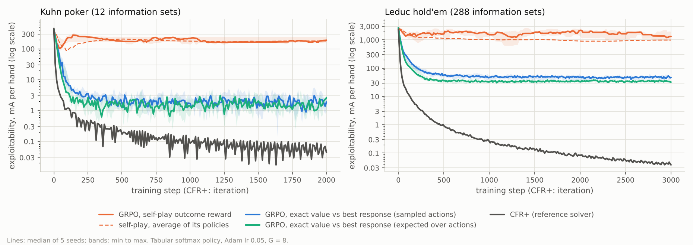
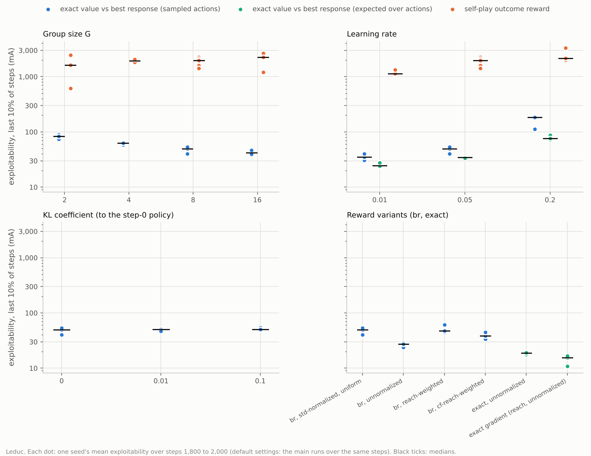
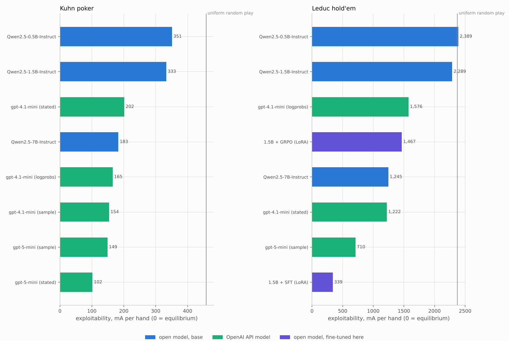
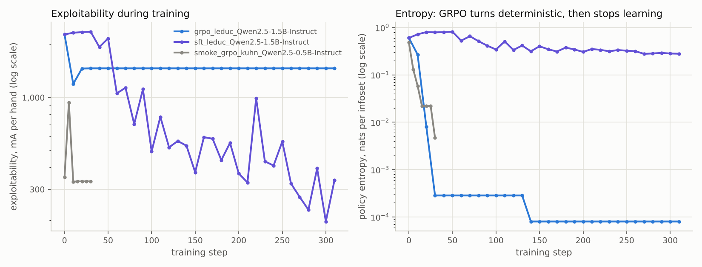

# NashTune research memo

**Question.** Language-model evaluations are mostly noisy judge scores. In small poker games the quality of any strategy can be measured exactly: its exploitability, the amount a perfect opponent wins from it per hand. How exploitable are language models when their answer probabilities are read as a complete strategy, which reward makes reinforcement learning reduce that number, and does the improvement survive a reworded prompt and an unseen variant of the game?

**Method.** Kuhn poker (12 information sets) and Leduc hold'em (288) are built as explicit game trees. A policy, whether a table of numbers or a language model, is turned into a complete strategy by reading its probability for every legal action at every information set; exploitability is then computed exactly with a best response. Training uses GRPO with rewards computed exactly from the game tree.

*Built 2026-10-16 by `nashtune report` from `results/`.*

## 1. The measurement is exact and matches an independent implementation

NashTune's game trees, best response and exploitability are a Python rewrite of ZeroSum's C++ code. `tests/fixtures/zerosum/` holds strategies in ZeroSum's file format and the numbers `zerosum eval` printed for them (10 significant digits). NashTune reproduces all of them:

| Game | Information sets | Strategies checked | Largest relative difference | Value to first player |
| --- | ---: | ---: | ---: | ---: |
| kuhn | 12 | 4 | 1.8e-10 | -0.055555556 |
| leduc | 288 | 4 | 1.5e-10 | -0.085606424 |
| leduc4 | 504 | 4 | 3.8e-10 | -0.102242921 |
| leduc5 | 780 | 2 | 3.9e-10 | -0.112768934 |

The differences are at the 10th significant digit, where ZeroSum's printout stops. The information sets also come out in the same order with the same actions. Exploitability is the average over both seats of what a best-responding opponent wins beyond the game value, in milli-antes per hand (mA); it is zero exactly at a Nash equilibrium.

## 2. Reward design: exact values against self-play outcomes (tabular study)

**Setup.** The policy is a table of logits, one per decision (a stand-in for a model with a separate parameter per situation), initialized at random. Each step applies one GRPO update: groups of G = 8 sampled actions, advantages (r − mean)/(std + 1e-6), the clipped objective with ε = 0.2, Adam with learning rate 0.05. Three rewards:

- **self-play**: deal 32 hands, play each 8 times with the current policy in both seats, reward every decision with the acting player's final payoff (the naive approach).
- **br**: at every information set, sample 8 actions and reward each with its exact value against the opponent's best response to the current policy (exploitability descent).
- **exact**: the same values, with the expectation over actions computed instead of sampled.

CFR+ is the reference. Seeds, settings and timings: `results/dynamics/manifest.json` (98 runs).

| Game | Method | Start (mA) | Final, median [range] (mA) | Last 10% of steps, median (mA) | Average policy, final (mA) |
| --- | --- | ---: | ---: | ---: | ---: |
| kuhn | CFR+ (average strategy) | 458 | 0.04 | 0.06 | n/a |
| kuhn | GRPO, self-play | 425 | 190 [163–247] | 176 | 179 |
| kuhn | GRPO, br | 425 | 1.88 [1.36–2.56] | 1.93 | 3.6 |
| kuhn | GRPO, exact | 425 | 2.57 [0.84–3.11] | 1.61 | 2.9 |
| leduc | CFR+ (average strategy) | 2,374 | 0.04 | 0.04 | n/a |
| leduc | GRPO, self-play | 2,671 | 1,329 [985–1,962] | 1,387 | 984 |
| leduc | GRPO, br | 2,671 | 46.86 [44.97–55.89] | 48.02 | 57.3 |
| leduc | GRPO, exact | 2,671 | 32.32 [30.42–36.10] | 35.16 | 40.2 |

Kuhn ran 2,000 steps and Leduc 3,000; 5 seeds per GRPO method (the seed sets the initial logits and the sampling). "Last 10%" is the mean over the last tenth of training, which smooths out step-to-step oscillation.



**What happened.**

- On Kuhn, exact rewards took exploitability from 425 mA to 1.9 (br) and 1.6 (exact) over the last 10% of training; self-play outcome rewards ended at 176 mA, 91 times the br level.
- On Leduc, exact rewards took exploitability from 2,671 mA to 48.0 (br) and 35.2 (exact) over the last 10% of training; self-play outcome rewards ended at 1,387 mA, 29 times the br level.
- Self-play does not settle. On Leduc its best point was 923 mA (median over seeds) but it ended at 1,329 mA; in 3 of 5 runs the final policy was more than 30% worse than the best one it had passed through. This is the cycling that policy-gradient self-play is known for in zero-sum games: each player adapts to the other's current play, which keeps moving.
- Averaging self-play's policies over time (what CFR does) barely changes it on Kuhn: 179 mA for the average against 190 for the last policy. Either way it stays far from the exact-reward runs.
- Averaging self-play's policies over time (what CFR does) lowers it on Leduc: 984 mA for the average against 1,329 for the last policy. Either way it stays far from the exact-reward runs.
- Taking the expectation over actions instead of sampling 8 helps: on Leduc 35.2 mA against 48.0. Neither comes near CFR+, which reached 0.04 mA in the same number of full-tree passes.

**Sensitivity** (Leduc, 2,000 steps, 3 seeds; at the default settings the 5 main runs over the same steps; numbers are medians of each run's mean over steps 1,800 to 2,000; `results/dynamics/final.csv`).

- Group size. With br rewards exploitability falls as G grows: G=2: 83.2, G=4: 62.8, G=8: 49.7, G=16: 41.9 mA. With self-play it rises: G=2: 1,628, G=4: 1,935, G=8: 1,970, G=16: 2,258 mA: more samples per step did not help self-play.
- Learning rate (lower is better at this horizon for every reward): br 0.01: 35.2, 0.05: 49.7, 0.2: 183 mA; exact 0.01: 24.7, 0.05: 34.7, 0.2: 76.2 mA; self-play 0.01: 1,134, 0.05: 1,970, 0.2: 2,166 mA.
- KL penalty to the step-0 policy (br): β=0: 49.7, β=0.01: 50.7, β=0.1: 50.5 mA, a small effect at these coefficients. Here the reference is the random initial policy; with a language model it is the base model.
- Reward variants: br, normalized (the default): 49.7 mA; br, unnormalized: 27.4 mA; br, reach-weighted: 47.4 mA; br, counterfactual-reach-weighted: 38.6 mA; exact, unnormalized: 18.8 mA; exact, reach-weighted, unnormalized (plain gradient descent on exploitability): 15.4 mA.
- Dividing by the group's standard deviation hurts late in training: near the equilibrium the action values at an infoset differ by little, and normalizing blows that small difference up to a full-size step, so the policy keeps moving around the equilibrium instead of settling. Lower learning rates and unnormalized advantages both end lower, which fits that reading.
- The language-model setting: 32 random information sets per step instead of all 288, and best responses recomputed every 10 steps. From 2,946 mA it reached 438 mA after 200 steps and 190 mA after 2,000; recomputing the best response every step instead gives 338 and 115. Ten-step-old rewards cost 64% at the end. A language model shares parameters across information sets, so it may move faster or slower than this table; these numbers set expectations, not predictions.
- Four times more self-play hands per step (128 deals instead of 32): 1,558 mA against 1,970.



The point of the study for the language-model runs: a verifiable reward is not enough by itself. The reward has to be the right quantity. Rewarding a decision with the hand's outcome gives an unbiased but noisy estimate of its value against the *current* opponent, and following it chases a moving target. Rewarding it with its value against the *best response* makes every update a step down the exploitability surface.

## 3. How exploitable are language models out of the box?

Each model's strategy is its exact probability of answering with each legal action word, renormalized over the legal actions. Legal mass is the probability the model put on a legal answer before renormalizing (1 = always answers with a legal word).

| Model | Game | Template | Exploitability (mA) | Seat 1 / seat 2 (mA) | Legal mass, mean (min) | Uniform play (mA) |
| --- | --- | --- | ---: | ---: | ---: | ---: |
| Qwen/Qwen2.5-0.5B-Instruct | kuhn | A | 351 | 290 / 413 | 0.960 (0.885) | 458 |
| Qwen/Qwen2.5-0.5B-Instruct | kuhn | B | 352 | 308 / 396 | 0.981 (0.964) | 458 |
| Qwen/Qwen2.5-0.5B-Instruct | leduc | A | 2,389 | 2,182 / 2,595 | 0.962 (0.744) | 2,374 |
| Qwen/Qwen2.5-0.5B-Instruct | leduc | B | 3,673 | 3,682 / 3,663 | 0.984 (0.970) | 2,374 |
| Qwen/Qwen2.5-0.5B-Instruct | leduc4 | A | 2,519 | 2,343 / 2,695 | 0.959 (0.750) | 2,409 |
| Qwen/Qwen2.5-1.5B-Instruct | kuhn | A | 333 | 278 / 389 | 0.962 (0.897) | 458 |
| Qwen/Qwen2.5-1.5B-Instruct | kuhn | B | 340 | 278 / 402 | 0.974 (0.941) | 458 |
| Qwen/Qwen2.5-1.5B-Instruct | leduc | A | 2,289 | 2,386 / 2,192 | 0.945 (0.785) | 2,374 |
| Qwen/Qwen2.5-1.5B-Instruct | leduc | B | 1,820 | 1,631 / 2,008 | 0.927 (0.711) | 2,374 |
| Qwen/Qwen2.5-1.5B-Instruct | leduc4 | A | 2,560 | 2,564 / 2,555 | 0.943 (0.770) | 2,409 |
| Qwen/Qwen2.5-7B-Instruct | kuhn | A | 183 | 107 / 259 | 0.999 (0.997) | 458 |
| Qwen/Qwen2.5-7B-Instruct | kuhn | B | 148 | 99.8 / 197 | 1.000 (0.999) | 458 |
| Qwen/Qwen2.5-7B-Instruct | leduc | A | 1,245 | 1,266 / 1,225 | 0.994 (0.800) | 2,374 |
| Qwen/Qwen2.5-7B-Instruct | leduc | B | 1,708 | 1,879 / 1,537 | 1.000 (0.997) | 2,374 |
| Qwen/Qwen2.5-7B-Instruct | leduc4 | A | 1,345 | 1,356 / 1,334 | 0.996 (0.835) | 2,409 |

Source: `results/mac/base/*.json` (strategies in `*_strategy.txt`, per-infoset detail in `*_infosets.csv`).

**What the base models show.**

- Kuhn, template A (0.5B 351, 1.5B 333, 7B 183 mA; uniform 458): every model was less exploitable than uniform random play.
- Leduc, template A (0.5B 2,389, 1.5B 2,289, 7B 1,245 mA; uniform 2,374): 0.5B was no better than uniform random play.
- leduc4, template A (0.5B 2,519, 1.5B 2,560, 7B 1,345 mA; uniform 2,409): 0.5B and 1.5B were no better than uniform random play.
- The wording of the prompt matters too: on Leduc, switching from template A to the paraphrase B moved exploitability 0.5B 2,389 → 3,673, 1.5B 2,289 → 1,820, 7B 1,245 → 1,708 mA, a factor of up to 1.5, and not always in the same direction.

## 4. GRPO with exact rewards on a language model

Trained on Leduc with template A; template B and leduc4 were never seen in training.

| Policy | Leduc, template A (mA) | Leduc, template B (mA) | leduc4, template A (mA) |
| --- | ---: | ---: | ---: |
| 1.5B, base model | 2,289 | 1,820 | 2,560 |
| grpo_leduc_Qwen2.5-1.5B-Instruct | 1,467 | 1,466 | 1,524 |
| sft_leduc_Qwen2.5-1.5B-Instruct | 339 | 1,507 | 917 |

Smoke test `smoke_grpo_kuhn_Qwen2.5-0.5B-Instruct` (kuhn): template A 351 → 333 mA, template B 352 → 333 mA.

Source: `results/mac/train/*.json`; training logs in `results/mac/train/logs/`.

**What happened.**

- `grpo_leduc_Qwen2.5-1.5B-Instruct` (br reward, 310 steps, 34 min): 2,289 → 1,467 mA on the training prompts; best measured 1,196 mA at step 10. Policy entropy 0.6 → 0.27 (step 10) → 0.0081 (step 20) → 0.00029 (step 30) nats per infoset; in 296 of 310 steps every group's sampled answers were identical, so there was no gradient at all; exploitability did not move after step 20. The final strategy is deterministic (one action above 0.999) at 288 of 288 information sets. Final legal mass 0.966; KL to the base model 0.71 nats per infoset.
- `sft_leduc_Qwen2.5-1.5B-Instruct` (sft reward, 310 steps, 84 min): 2,289 → 339 mA on the training prompts; best measured 197 mA at step 300. Over the last third of training the measured values ranged from 197 to 992 mA. Final mean entropy 0.28 nats per infoset. Final legal mass 0.845; KL to the base model 0.91 nats per infoset.
- `smoke_grpo_kuhn_Qwen2.5-0.5B-Instruct` (br reward, 30 steps, 0 min): 351 → 333 mA on the training prompts; best measured 331 mA at step 10. Policy entropy 0.48 → 0.059 (step 10) → 0.022 (step 20) → 0.0047 (step 30) nats per infoset; in 18 of 30 steps every group's sampled answers were identical, so there was no gradient at all; exploitability did not move after step 15. The final strategy is deterministic (one action above 0.999) at 9 of 12 information sets. Final legal mass 0.863; KL to the base model 0.83 nats per infoset.

- **GRPO collapsed.** A group-relative advantage is zero when all 8 sampled answers agree, and with advantages divided by the group's standard deviation every group that does differ produces a full-size step however small the value gap. The language model, whose LoRA parameters are shared across all 288 information sets, had a mean entropy below 0.01 nats by step 20. A deterministic policy produces identical samples, so every later group was skipped and learning stopped for good, at a pure strategy worse than its own best measured checkpoint (1,196 mA at step 10). The tabular study in section 2, with one parameter per decision, never reached that state. The run used no KL penalty to the base model (coefficient 0.0) and kept only its last two checkpoints.
- **Imitation worked on the training prompt and mostly stayed there.** Supervised fine-tuning on the CFR+ strategy cut Leduc exploitability by 85% with template A (2,289 → 339 mA), by 64% on the unseen four-rank deck (2,560 → 917), and by only 17% under the reworded prompt (1,820 → 1,507).
- The collapsed GRPO policy scored about the same everywhere: 1,467 (A), 1,466 (B), 1,524 mA (leduc4).

## 5. OpenAI models

| Model | Mode | Game | Template | Exploitability (mA) | Legal mass or invalid answers | Tokens | Cost |
| --- | --- | --- | --- | ---: | --- | ---: | ---: |
| gpt-4.1-mini | logprobs | kuhn | A | 165 | legal mass 1.000 | 1,701 | $0.001 |
| gpt-4.1-mini | logprobs | kuhn | B | 137 | legal mass 0.999 | 1,644 | $0.001 |
| gpt-4.1-mini | logprobs | leduc | A | 1,576 | legal mass 1.000 | 62,538 | $0.025 |
| gpt-4.1-mini | logprobs | leduc | B | 1,515 | legal mass 1.000 | 61,458 | $0.025 |
| gpt-4.1-mini | sample | kuhn | A | 154 | 0 invalid, 0 infosets defaulted to uniform | 1,929 | $0.001 |
| gpt-4.1-mini | stated | kuhn | A | 202 | 0 invalid, 0 infosets defaulted to uniform | 2,265 | $0.001 |
| gpt-4.1-mini | stated | leduc | A | 1,222 | 0 invalid, 0 infosets defaulted to uniform | 77,332 | $0.037 |
| gpt-5-mini | sample | kuhn | A | 149 | 0 invalid, 0 infosets defaulted to uniform | 58,000 | $0.069 |
| gpt-5-mini | sample | kuhn | B | 141 | 0 invalid, 0 infosets defaulted to uniform | 67,008 | $0.089 |
| gpt-5-mini | sample | leduc | A | 710 | 2 invalid, 0 infosets defaulted to uniform | 838,713 | $1.244 |
| gpt-5-mini | stated | kuhn | A | 102 | 0 invalid, 0 infosets defaulted to uniform | 4,487 | $0.005 |

Tokens and cost count only requests sent in that run (cached answers are free). Source: `results/mac/openai/*.json`, ledger `spend.json`.

**What the API models show.**

- Kuhn: lowest was gpt-5-mini (stated, template A) at 102 mA.
- Leduc: lowest was gpt-5-mini (sample, template A) at 710 mA, from 4 sampled answers per information set (sampling noise adds exploitability, so the model's own strategy is somewhat better than this).
- Read exactly from its log-probabilities, gpt-4.1-mini scored 1,576 (A) and 1,515 (B) mA on Leduc, much less sensitive to the wording than the small open models.
- The fine-tuned 1.5B model `sft_leduc_Qwen2.5-1.5B-Instruct` (339 mA on Leduc, template A) was less exploitable than every API model measured here, but only with the prompt it was trained on (section 4).
- Total API spend for this section: $1.50.





## 6. Limits

- These are research-sized games. The method needs the whole game tree, which rules out real poker.
- A strategy read from a model's answer probabilities is one way to define the model's play. A model that reasons before answering may play differently; the `sample` mode measures that, with sampling noise.
- The tabular study uses one optimizer, one initialization scale and fixed hyperparameters per sweep; conclusions about rates are specific to them.
- `br` rewards need an exact best response, which needs the full tree. That is what makes them verifiable here and what keeps the method from scaling as is.
- Each language-model training result is one run (one seed, one set of hyperparameters: LoRA rank 16, learning rate 1e-4, no KL penalty). The GRPO collapse is a property of that setting, not of GRPO in general.
- Sampled API results use 4 answers per information set, so their exploitability includes sampling noise.

## Reproduce

```bash
make test            # unit tests (NumPy only)
nashtune dynamics    # section 2 (about an hour on two cores)
make mac-all         # sections 3 to 5, on a Mac (see docs/mac-and-github.md)
nashtune report      # this memo
```
